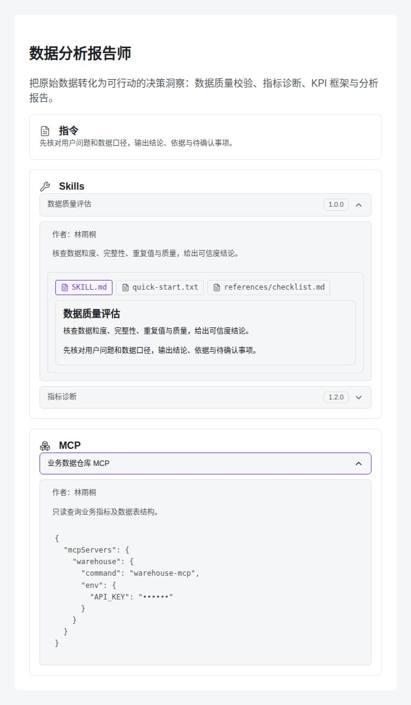

# Expert dependency detail preview

Expert details and expert-team member details show Skills and MCP connectors as
expandable cards with their description and creator attribution. Missing creator
names are displayed as "Not provided".

For a pinned Skill relation, the display version, description, Markdown, and
supporting files come from the referenced version. Failed pinned reads surface
an error and do not fall back to the current head. Creator display names are
optional graph metadata, matched by both plugin ID and version ID. Connectors
are not versioned; their own metadata and safely redacted MCP configuration are
shown. Legacy inline MCP configuration remains supported.

To verify the feature, open an expert (or an expert-team member), expand a Skill,
and switch between SKILL.md and its supporting files. Expand an MCP card to
check its description, creator and masked configuration.

The screenshot below uses local fixture data with the production detail
components and theme styles; it is not evidence of a test-environment deployment.

